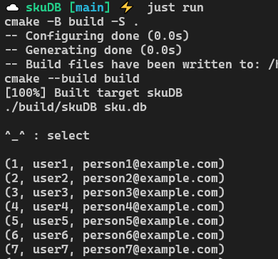

### skuDB 😾

#### Meowing my way into the world of databases!

#### skuDB is an sqlite-inspired database built using C++. It is built purely for learning purposes, getting to know databases at a deeper level. 

## How to run skuDB?

1. Download the zip file and extract it.
2. Run `just run` and there's that beautiful cat prompt.

    

## What did I learn by building skuDB?

1. Got to know about sqlite's internal architecture at a deeper level. 
2. I now understand b-trees (rather b+ trees) at a deeper level.
3. More comfortable with memory management and file handling. 

## Future of skuDB

Currently, skuDB only supports SELECT and INSERT statements.
As of now, users can only work with one table and that too with a pre-defined schema. 
So, in future I want to add features like:
1. Support for UPDATE and DELETE statements. 
2. Ability to work with multiple tables

Peace!
